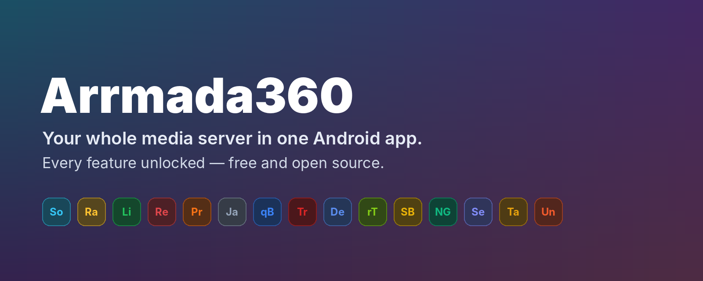
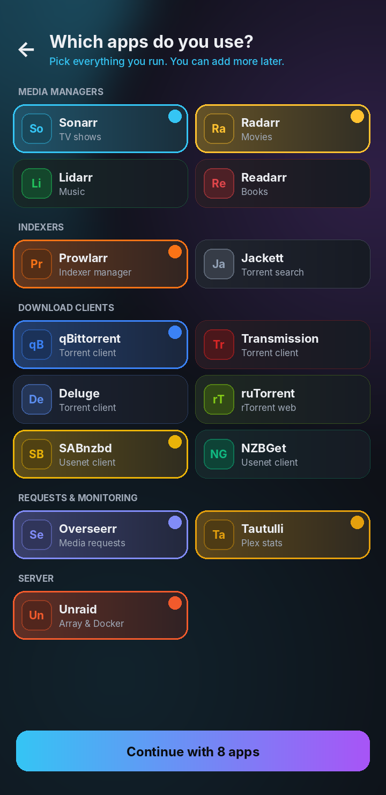
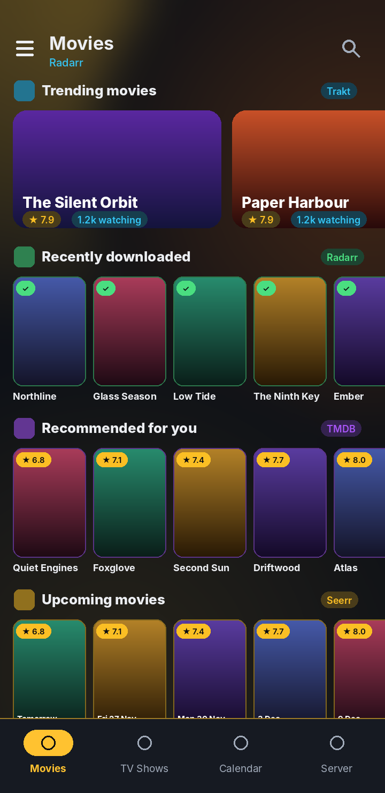
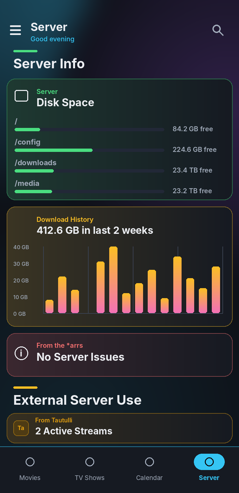
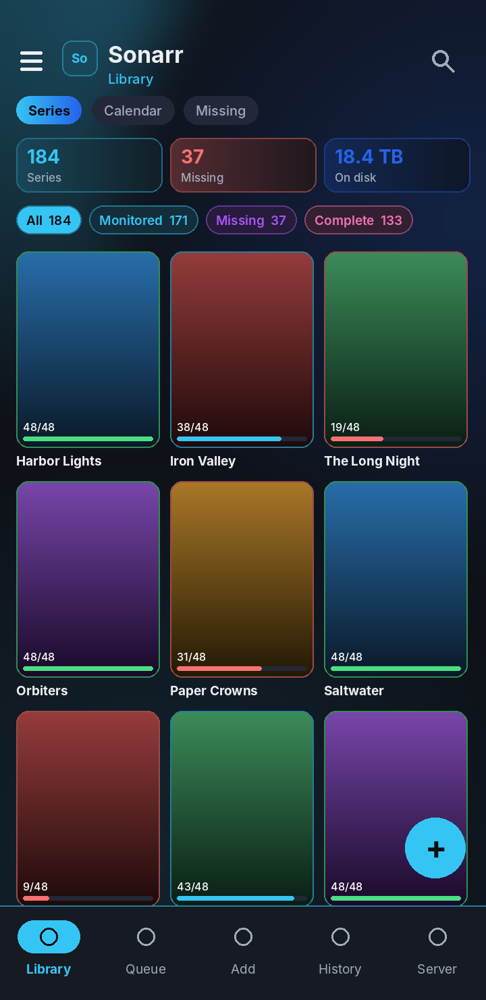
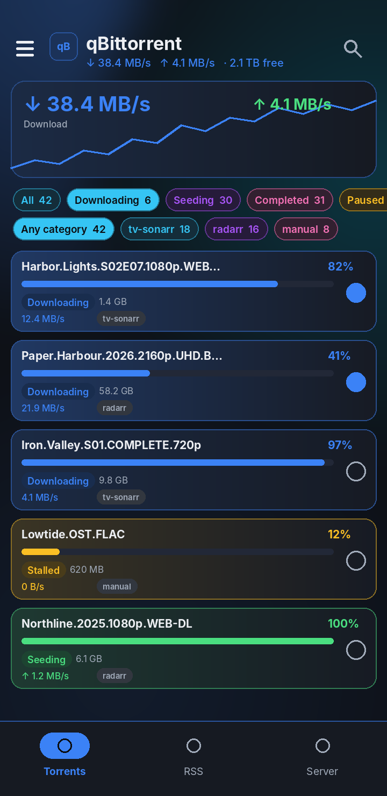
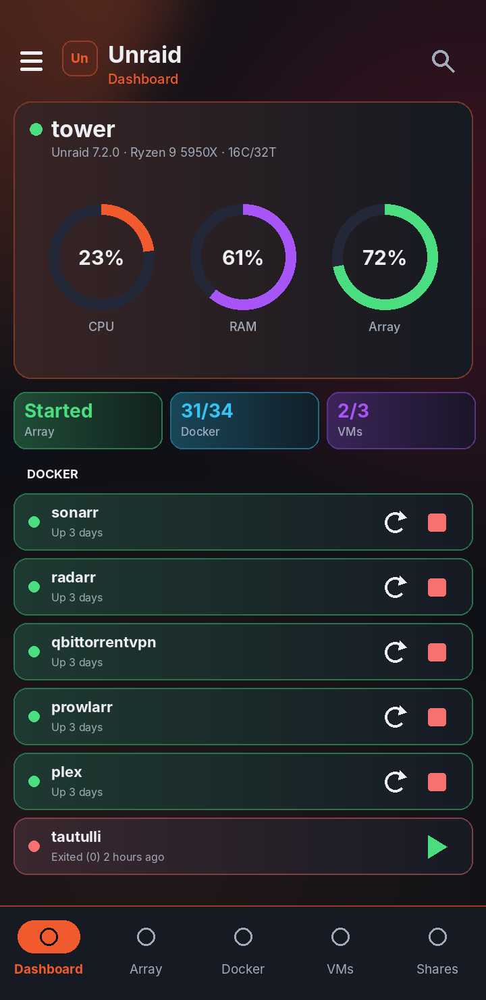
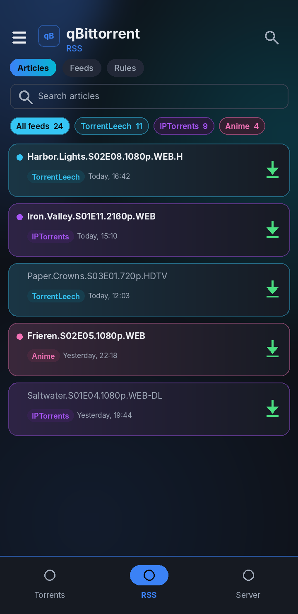
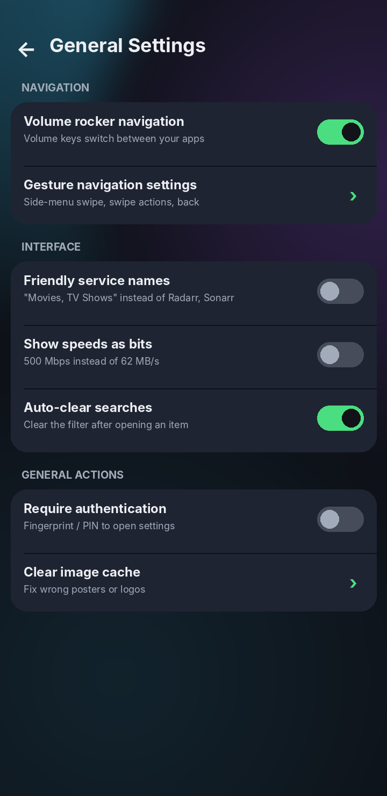

<p align="center">
  
</p>

<p align="center">
  <a href="../../releases/latest"></a>
  <a href="../../actions/workflows/build.yml"></a>
  
  
</p>

# Arrmada360

**Arrmada360** is a free, open-source Android app for running your whole self-hosted media stack from your phone, in the spirit of nzb360.
One app covers Sonarr, Radarr, Lidarr, Readarr, Prowlarr, Jackett, qBittorrent, Transmission, Deluge, ruTorrent, SABnzbd, NZBGet, Overseerr/Jellyseerr, Tautulli and Unraid.

**Every feature is unlocked.** There are no subscriptions, no "pro" tiers and no ads. The app only talks to your own servers and to the discovery sources you choose to add.

> [!NOTE]
> The images below are **design previews** drawn from the app's real layout and colours. They are not captures from a phone.
> To swap in real screenshots, take them on your phone and overwrite the files in [`docs/screenshots/`](docs/screenshots), keeping the same file names.

---

## Contents

- [Screens](#screens)
- [Supported apps and features](#supported-apps-and-features)
- [Install](#install)
- [First-time setup](#first-time-setup)
- [Where to find each API key](#where-to-find-each-api-key)
- [Dashboard](#dashboard)
- [Settings](#settings)
- [Notifications](#notifications)
- [Deep links](#deep-links)
- [Backup and restore](#backup-and-restore)
- [Remote access](#remote-access)
- [Troubleshooting](#troubleshooting)
- [Building from source](#building-from-source)
- [Privacy](#privacy)
- [Credits](#credits)
- [License](#license)

---

## Screens

| First-run app picker | Movies discovery | Server info |
|:---:|:---:|:---:|
|  |  |  |
| **Pick the apps you run, then connect each one** | **Trending, recently downloaded, recommended, upcoming** | **Disk space, 2-week download history, \*arr health** |

| Sonarr library | qBittorrent | Unraid |
|:---:|:---:|:---:|
|  |  |  |
| **Poster grid, filters, stats, bottom tabs** | **Live speed chart, filters, categories, multi-select** | **CPU, RAM and array gauges, Docker controls** |

| qBittorrent RSS | General settings |
|:---:|:---:|
|  |  |
| **RSS articles across feeds, one-tap download** | **nzb360-style grouped settings** |

---

## Supported apps and features

Every app gets its own colour theme, its official logo and its own bottom tab bar.

### 📺 Sonarr · 🎬 Radarr · 🎵 Lidarr · 📚 Readarr

Bottom tabs: **Library · Queue · Add · History · Server**

- **Library:** poster grid with summary tiles (total, missing, size on disk), search, sort (title, recently added, year, size) and filter chips with counts (all, monitored, missing, complete, unmonitored). Poster size is adjustable.
- **Calendar** and **Missing** views sit at the top of the Library tab. Missing items have a one-tap search.
- **Details page:**
  - backdrop, poster, overview, path, quality, genres and an *Open on IMDb* button
  - monitor or unmonitor the whole title, a season or a single episode, album or book
  - automatic search, plus **interactive search** that lists releases with quality, size, seeders, age, custom-format score and rejection reasons, and grabs one with a tap
  - refresh and rescan, and delete with or without files
- **Add:** search by name, or by `tmdb:` / `tvdb:` / `imdb:` ID. Then pick the root folder, quality profile, metadata profile, monitor option, minimum availability (Radarr) or series type (Sonarr), and choose whether to start searching straight away.
- **Queue:** live progress, status and warnings. You can remove an item from the download client or blocklist it.
- **History:** colour-coded events (grabbed, imported, failed, deleted).
- **Server tab:**
  - instance settings and *View on web*
  - **Manual import:** scan a folder or a stuck queue item, review the matches, then import by move or copy
  - **RSS sync**, **Update library**, **Search all missing** and **Refresh downloads**
  - **System status:** version, health warnings, disk space, scheduled tasks you can run now, and restart

### 🔎 Prowlarr · Jackett

- **Search** every indexer, with category chips (Movies, TV, Music, Books, Anime, PC) and sorting by seeders, size, newest or title.
- Send any result to **any download client you've added**, use *Grab with Prowlarr's own client*, copy the magnet link or open the details page.
- **Prowlarr only:**
  - **Indexers:** list them, test them, and enable or disable each one
  - **Stats:** queries, grabs, failures and response times
  - **History**
  - **Server:** status, health and tasks

### ⬇️ qBittorrent · Transmission · Deluge · ruTorrent · SABnzbd · NZBGet

Bottom tabs: **Torrents (or Queue + History) · RSS · Server**

- **List:** live speed chart, filter chips with counts (downloading, seeding, completed, paused, active, errored), category chips, and sorting by added, name, progress, size, speed or ratio.
- **Swipe** a download right to pause or resume it, or left to delete it. Both can be turned off in Settings.
- **Multi-select:** long-press, or choose *Select multiple*. Then:
  - select all shown, invert or select none
  - bulk resume, pause, delete (with or without files) or set a category
  - force start and recheck (qBittorrent)
- **Categories** (qBittorrent) and **labels** (ruTorrent): set, change, create (with a save path on qBittorrent) or remove.
- **Add** a torrent or NZB by magnet link or URL, or share a magnet link to Arrmada360 from any other app.
- **RSS** (qBittorrent and ruTorrent):
  - **Articles** from every feed: search, filter by feed, unread only, one-tap download, send to another client, read the description, mark as read
  - **Feeds:** add, refresh and remove, with error status
  - **Auto-download rules** (qBittorrent): must contain / must not contain, regex, episode filter, category, save path and feeds, plus a **preview of matching articles**
  - switches for the qBittorrent RSS reader and auto-download
- **Extras:**
  - pause and resume everything
  - qBittorrent alternative speed limits
  - SABnzbd speed limits
  - Usenet history

### 🙋 Overseerr / Jellyseerr

- **Requests:** filter by pending, approved, processing, available or all. Approve, decline, retry or delete.
- **Discover:** trending, popular movies, popular TV and upcoming, plus search. You can request titles, including 4K.
- **Users:** request counts per user.
- **Server:** version and update status, and jobs you can run now.

### 📊 Tautulli

- **Activity:** live streams with progress, direct play or transcode, quality, location and bandwidth. You can **stop a stream** and show the viewer a message.
- **History**, **Stats** (most watched, most active users, platforms, last 30 days) and **Users**.
- **Server:** Plex server info and libraries.

### 🖥️ Unraid (7.2+ official API)

Bottom tabs: **Dashboard · Array · Docker · VMs · Shares**

- **Dashboard:**
  - hostname, version, CPU model, and CPU, RAM and array **gauges**
  - disk warnings for errors and hot disks
  - unread **notifications** you can dismiss
  - **Reboot** and **Shut down**, with a confirmation
- **Array:**
  - **start or stop the array**
  - **parity check**: check, check & correct, pause, resume and cancel, with progress
  - parity, data and cache disks with temperature, errors, spinning or spun down, filesystem and space used
- **Docker:** search, filter running or stopped, start, stop, restart, pause and unpause, plus **Start all** and **Stop all**.
- **VMs:** start, stop, pause, resume, reboot and force stop.
- **Shares:** every share with space used and free, and its cache setting.

### Everything else

- **Connection check:** tests every app at once and shows the version and response time, or an error in plain English, for example:
  - "Wrong API key"
  - "Connection refused – check the port"
  - "Timed out – is your phone on Tailscale?"
- **Search everything:** searches all your libraries at once, and finds new titles to add.
- **Multiple instances** of the same app (for example Radarr and Radarr 4K).
- **Self-signed HTTPS** support for each app.

---

## Install

1. On your Android phone, open the **[latest release](../../releases/latest)** and download **`Arrmada360.apk`**.
2. Open the file. The first time, Android asks you to allow installs from your browser or file manager.
3. To update later, download the new APK and install it over the old one. Your settings are kept.

Every push to `main` builds a new APK automatically and publishes it to the `latest` release.

Requires **Android 8.0 (API 26) or newer**.

---

## First-time setup

1. Tap **Get started**.
2. **Tick every app you run.** They're grouped as media managers, indexers, download clients, requests and monitoring, and server.
3. For each app, enter:
   - **Address**, e.g. `http://192.168.1.10:8989`. Add a URL base if you use one, e.g. `http://192.168.1.10/sonarr`.
   - The **API key**, or the **username and password** for qBittorrent, Transmission, ruTorrent and NZBGet. Deluge only needs its password.
   - Tick **Allow self-signed HTTPS certificates** if your server uses one.
4. Tap **Test**. A green tick shows the version, and a red message tells you what to fix. Then tap **Save**.

You can add, edit, reorder or remove apps later in **Settings → Your apps**. Long-press an app there to reorder or remove it.

---

## Where to find each API key

| App | Default port | Where to find the key or login |
|---|---|---|
| Sonarr / Radarr / Lidarr / Readarr / Prowlarr | 8989 / 7878 / 8686 / 8787 / 9696 | *Settings → General → Security → API Key* |
| Jackett | 9117 | API Key, top right of the Jackett dashboard |
| qBittorrent | 8080 | Web UI username and password (*Tools → Options → Web UI*) |
| Transmission | 9091 | RPC username and password. Leave blank if authentication is off |
| Deluge | 8112 | Web UI password (default `deluge`) |
| ruTorrent | 80 | Basic-auth login if you use one. Needs the **httprpc** plugin, and the **rss** plugin for RSS |
| SABnzbd | 8080 | *Config → General → Security → API Key* |
| NZBGet | 6789 | *Settings → Security → ControlUsername / ControlPassword* |
| Overseerr / Jellyseerr | 5055 | *Settings → General → API Key* |
| Tautulli | 8181 | *Settings → Web Interface → API Key* |
| Unraid 7.2+ | 80 / 443 | *Settings → Management Access → API Keys*. Create a key with the **Admin** role |

---

## Dashboard

The dashboard opens from **Dashboard** in the side menu and has four bottom tabs.

| Tab | What it shows |
|---|---|
| **Movies** | Trending (large picture cards), Recently downloaded, Recommended for you, Most anticipated, Upcoming, Popular, Popular people, and a link to your full Radarr library |
| **TV Shows** | The same rows for shows, using Sonarr |
| **Calendar** | Everything coming up from all your media apps, grouped by day, with each app's logo and a filter |
| **Server** | **Server Info**: disk space, 2-week download history chart, *arr health issues. Then your **Unraid** summary, **live downloads**, **Other Services** (recently downloaded books and albums), **External Server Use** (Tautulli streams, Seerr pending requests) and an online/offline tile for every app |

Tap a title in any discovery row to open its details. From there you can **Add to Radarr/Sonarr**, **Request with Seerr** or **Open on TMDB**. Posters show a ✓ when the title is already in your library.

**Where the discovery rows come from.** Each row tries **Trakt** first, then **TMDB**, then your **Overseerr/Jellyseerr**, and uses whichever one answers.

- Seerr works with no extra setup.
- For richer rows, add free keys in **Settings → Discovery sources**:
  - **TMDB API key:** themoviedb.org → *Settings → API*.
  - **Trakt Client ID:** trakt.tv/oauth/applications → *New application*.

---

## Settings

| Page | Options |
|---|---|
| **Your apps** | Add, edit, reorder (long-press) and remove apps. *Test all connections* |
| **General settings** | **Navigation:** volume rocker navigation (volume keys switch apps), gesture settings (side-menu swipe, download swipe actions, back goes to the dashboard). **Interface:** friendly service names ("Movies" instead of "Radarr"), speeds in bits, auto-clear library search, What's New on update. **Integrations:** open IMDb links in the browser or the IMDb app. **Actions:** require fingerprint or PIN for settings, local crash logs, clear image cache, clear cached app data |
| **Notifications** | Turn the background checker on, choose which apps alert you, *Check now*, deep links |
| **Backup & restore** | Create a `.zip` backup, restore from a file, copy or paste as text |
| **Appearance** | AMOLED black, number of poster columns |
| **Discovery sources** | TMDB key and Trakt Client ID |

---

## Notifications

Turn them on in **Settings → Notifications**. Arrmada360 checks your servers about **every 15 minutes**, the most often Android allows, and posts an alert for:

- **Radarr:** new movies downloaded
- **Sonarr:** new episodes downloaded
- **Lidarr:** new music downloaded
- **Readarr:** new books downloaded
- **Seerr:** new requests, flagged "needs approval" when pending
- **Download clients:** finished torrents or NZBs (off by default)

Some things to know:
- Tapping a notification opens that app in Arrmada360.
- The first check after you turn notifications on only records what's already there, so you won't get a flood of old downloads.
- Your phone must be able to reach your servers, at home or over a VPN such as Tailscale.
- Some phones' battery savers delay background checks. If alerts arrive late, exempt Arrmada360 from battery optimisation.

---

## Deep links

Open any of these from Notifiarr, Ntfy, Tasker, a browser bookmark or a home-screen shortcut:

```
arrmada360://dashboard        arrmada360://movies       arrmada360://tv
arrmada360://calendar         arrmada360://server       arrmada360://search
arrmada360://health           arrmada360://settings
arrmada360://service/<app name>     e.g. arrmada360://service/Sonarr
```

*Settings → Notifications → Arrmada360 deep links* lists every link for your own apps, with copy buttons.

---

## Backup and restore

- **Settings → Backup & restore → Create a backup** saves every app, every preference and your discovery keys to `arrmada360-backup-YYYY-MM-DD.zip`.
- **Restore from a file** replaces all current settings with the ones in a backup. Restoring older text exports also works.

> [!WARNING]
> Backups contain your API keys and passwords. Keep them private.

---

## Remote access

Arrmada360 connects straight to the addresses you enter, so anything that works in your phone's browser works in the app:

- **On your home network:** `http://192.168.x.x:port`
- **Tailscale or another VPN:** use the Tailscale IP or MagicDNS name, e.g. `http://tower:8989`
- **Reverse proxy or Cloudflare Tunnel:** `https://sonarr.example.com`. Proxies that put their own login page in front of the app, such as Cloudflare Access, will block the API.

---

## Troubleshooting

| Message | What to check |
|---|---|
| *Wrong API key or login (HTTP 401/403)* | Copy the key again from the app's settings. qBittorrent also bans an IP after too many failed logins |
| *Not found (HTTP 404)* | Wrong port, or a URL base is missing, e.g. `/sonarr` |
| *Connection refused* | The app isn't running, or the port is wrong |
| *Timed out* | Your phone isn't on the same network or VPN |
| *HTTPS problem* | Use `http://`, or tick *Allow self-signed HTTPS certificates* |
| *Unexpected reply (not JSON)* | The address points at a login page or a different app |
| Unraid: "Cannot query field…" | Needs Unraid **7.2+** and an API key with the **Admin** role |
| ruTorrent RSS empty | Enable the **rss** plugin in ruTorrent |
| Wrong posters or logos | *Settings → General → Clear image cache* |

To report a crash: *Settings → General → View last crash log → Share*.

---

## Building from source

Requirements: **JDK 17** and the **Android SDK** (Android Studio includes both).

```bash
git clone https://github.com/bdlnaredi/Arrmada360.git
cd Arrmada360
./gradlew assembleRelease        # → app/build/outputs/apk/release/app-release.apk
```

You can also open the folder in **Android Studio** and press **Run**.

| | |
|---|---|
| Language / UI | Kotlin 2.0, Jetpack Compose, Material 3 |
| Networking | OkHttp 4, `org.json` |
| Images | Coil 2 |
| Background work | WorkManager |
| Minimum / target SDK | 26 / 35 |
| CI | GitHub Actions ([`build.yml`](.github/workflows/build.yml)): builds a signed release APK and publishes it to the `latest` release |

### Project layout

```
app/src/main/java/com/arrmada360/app/
├── MainActivity.kt          app entry: deep links, volume keys, crash logger
├── data/                    saved services and preferences, app events
├── net/                     OkHttp client, JSON helpers, friendly error messages
├── api/                     one client per service, plus discovery feeds and connection status
├── notify/                  background notification worker
└── ui/
    ├── Common.kt            design system: cards, tabs, charts, gauges, shimmer…
    ├── Shell.kt             navigation, side menu, deep-link routing
    └── screens/             every screen (dashboard, *arr, downloads, RSS, Unraid, settings…)
docs/
├── screenshots/             images used in this README
└── make_previews.py         redraws the preview images
```

> [!IMPORTANT]
> The release signing key (`app/arrmada360.jks`) is committed so that every CI build can install over the previous one. Anyone could use it to sign an APK that looks like an Arrmada360 update. Before you hand the app to other people, move the key into GitHub Actions secrets.

---

## Privacy

- No analytics, no ads and no tracking.
- Your settings, API keys and passwords stay on your phone, in the app's private storage.
- The app only sends requests to:
  - your own servers
  - TMDB, Trakt or your Seerr, if you set them up for discovery
  - the jsDelivr CDN, to download app logos
- Crash logs are saved on your phone only, and only shared when you choose to share them.

---

## Credits

- App logos come from **[dashboard-icons](https://github.com/homarr-labs/dashboard-icons)** (Apache-2.0) and are loaded at runtime. Each logo belongs to its project.
- Discovery data is from **[TMDB](https://www.themoviedb.org/)** and **[Trakt](https://trakt.tv/)**. This product uses the TMDB API but is not endorsed or certified by TMDB.
- Inspired by **nzb360**. Arrmada360 is an independent project and isn't affiliated with nzb360 or with any of the apps it connects to.

See the [CHANGELOG](CHANGELOG.md) for what changed in each build.

---

## License

[MIT](LICENSE) © bdlnaredi
